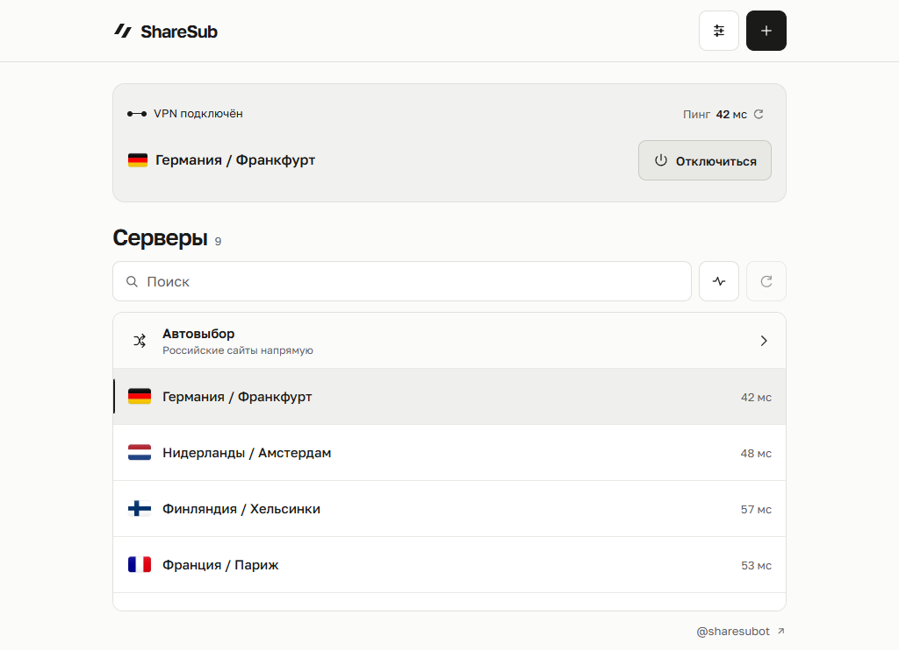
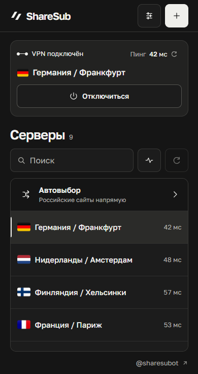

<div align="center">


# ShareSub

**VPN-клиент на Xray-core для Android и Windows**

[Скачать Android APK](https://app.sharesub.ru/download/android) · [Скачать Windows x64](https://app.sharesub.ru/download/windows) · [Сайт](https://app.sharesub.ru) · [Telegram](https://t.me/sharesubot)

</div>

<div align="center">
  
  
</div>

<p align="center"><sub>Интерфейс ShareSub с демонстрационными серверами.</sub></p>

## Быстрый старт

1. Установите приложение на Android 10+ или Windows x64.
2. Нажмите **+** и добавьте ссылку на подписку, отдельный сервер или файл Xray JSON.
3. Выберите сервер и нажмите **Подключиться** или запустите **Автовыбор** из первой строки списка.

Android запрашивает разрешение на VPN. Windows запрашивает права администратора при запуске установленного ShareSub, чтобы приложение могло управлять системным туннелем.

## Возможности

| | |
| --- | --- |
| **Импорт** | ShareSub и сторонние подписки, Base64, Xray JSON, ссылки VLESS, VMess, Trojan, Shadowsocks и Hysteria2. |
| **Серверы** | Поиск, TCP-пинг, группировка по странам и переключение сервера одним нажатием во время подключения. Длинные списки загружаются порциями. |
| **Автовыбор** | Балансер Xray проверяет до 24 кандидатов и выбирает доступный сервер с наименьшей задержкой в пуле. Для отдельных стран есть свои балансеры. |
| **Маршрутизация** | В «Автовыборе» домены `.ru`, `.рф`, `.su` и российские IP идут напрямую. |
| **Настройки** | Светлая и тёмная темы, отдельные переключатели ОЗУ Xray и разряда батареи, список сохранённых провайдеров. |
| **Обновления** | Клиент проверяет подпись манифеста и SHA‑256 установщика. Установка начинается после подтверждения. |

## Сборка из исходников

### Windows x64

Требуется Node.js 22.

```powershell
npm ci
powershell -ExecutionPolicy Bypass -File scripts/fetch-core.ps1 windows
npm run build:windows
```

Для локального запуска используйте `npm start`. Тестовая копия использует отдельный профиль и запрашивает права при подключении.

### Android

Требуются JDK 17, Gradle 8.14 и Android SDK 35. Из PowerShell запустите:

```powershell
npm run build:android
```

Команда создаёт отладочный APK в `dist/`. Для распространения соберите release APK и подпишите его своим ключом.

### Тесты

```powershell
npm test
npm run bench -- "путь-к-файлу-подписки"
```

## Интеграция

- Диплинк для Android и Windows — `sharesub://import?url=<urlencoded>`.
- HTTPS-вариант — `https://app.sharesub.ru/import?url=<urlencoded>`.
- [Манифест обновлений](https://app.sharesub.ru/api/latest.json) содержит актуальную версию, ссылки, размеры и SHA‑256 установщиков.
- [Технические заметки](docs/technical.md) описывают HWID, измерения, структуру проекта и публикацию сборок.

## Компоненты

Клиент использует [Xray-core](https://github.com/XTLS/Xray-core) и [libXray](https://github.com/XTLS/libXray). Шрифт [Golos Text](https://github.com/googlefonts/golos-text) распространяется по OFL, флаги основаны на [flag-icons](https://github.com/lipis/flag-icons) под MIT. Лицензии этих ресурсов включены в проект и сборки.
